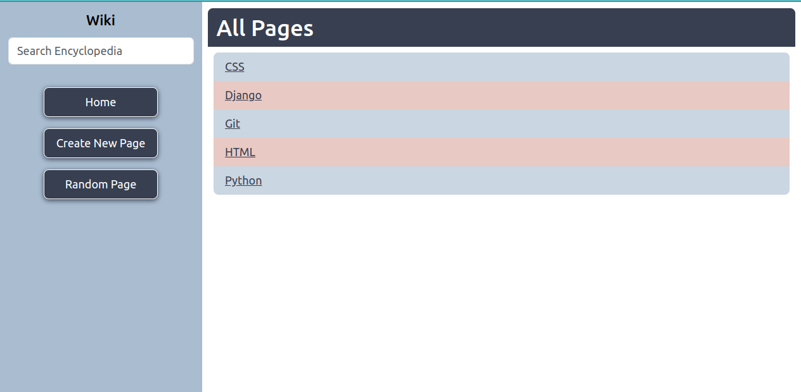

# Wikipedia-Like :books:

A Django app that stores and displays encyclopedia entries using Markdown. A CS50W course project.

## About

For the project I created a Markdown to HTML parser. Although basic, in its current stage, it can process heading, unordered list items at different levels, bold text, and links. It was an interesting challenge that helped me to gain more experience with Python. There is also built-in support for forms which is fantastic. It allows you to create tokens to help prevent CSFRs and you can also add user input verification on the backend.



## Tech Stack

- Django framework
- Python 3.6
- Pip
- CSS3
- HTML5

## Run Locally

1. Clone the project, which can be done by running the command below:

```bash
git clone https://github.com/webshuriken/wikipedia-like
```

2. You willl also need at least Python v3 installed. You can find the latest version on the [Python official site](https://www.python.org/downloads/).

```bash
# check your version of Python
python --version
```
## Features

- Read any encyclopedia entry stored in the app
- Make changes to any encyclopedia entry
- Create new entries using Markdown
- Search for entries by using the search bar
- Load a random encyclopedia entry
- Kept the app as accessible as possible
- The form prevents CSRF and checks users input is valid

## Roadmap

### Version 1.1.0

- [ ] Add Auth so only registered users can edit or add entries
- [ ] Able to connect to an External DB and not rely on just the Django built-in one.

### Version 1.3.0 - Improve Markdown to HTML

- [ ] Support for ordered lists
- [ ] Support for tables

## Contributing

Pull requests are welcomed.

- Fork the repo
- Clone locally or not
- Create your changes
- Make a pull request

## Acknowledgements

 - [CS50](https://pll.harvard.edu/course/cs50s-web-programming-python-and-javascript?delta=0) for providing the base distribution code and lesson to go with it, thank you.
 - [Django Form Docs](https://docs.djangoproject.com/en/4.1/topics/forms/)
 - [Python regex docs](https://docs.python.org/3/howto/regex.html)
 - [Markdown Guide](https://www.markdownguide.org/)
 - [GitHub Markdwon Guide](https://docs.github.com/en/get-started/writing-on-github/getting-started-with-writing-and-formatting-on-github/basic-writing-and-formatting-syntax)

## Authors

- [CS50](https://pll.harvard.edu/course/cs50s-web-programming-python-and-javascript?delta=0)
- [Carlos E Alford](https://carlosealford.com/)

## License

[MIT](LICENSE)
